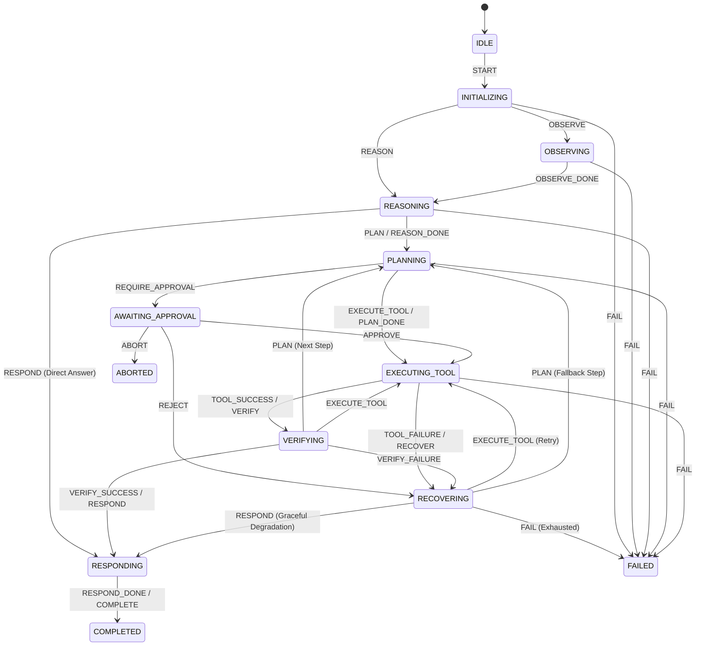
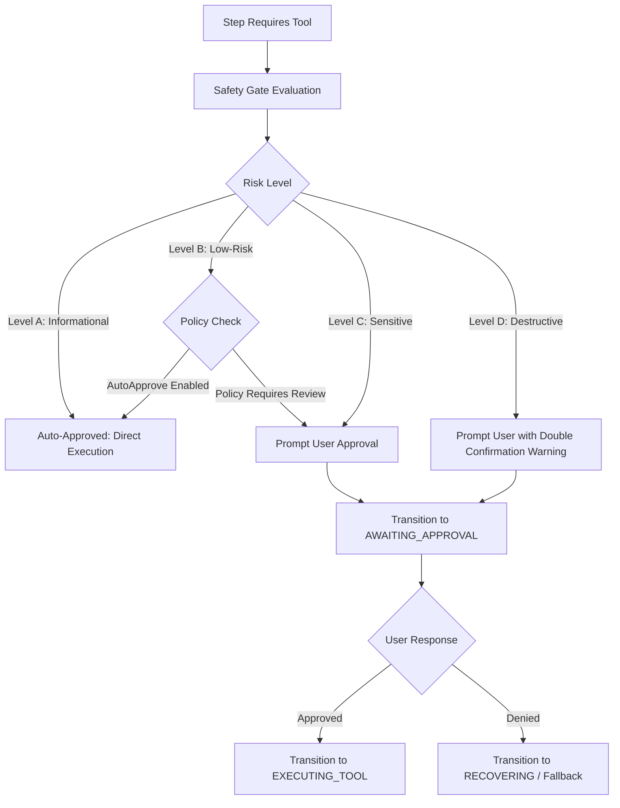

# System Architecture Specification

**Product:** Academia AI Voice Co-Pilot  
**Component:** Agentic Workflow Orchestrator, State Machine & Mock Tool Executor  
**Document Version:** 1.0  
**Target Branch:** `team/sde-8-voicebot`  

---

## 1. Architectural Principles

This component implements the intelligence and execution layer of the AI Voice Co-Pilot system adhering to the following design tenets:
1. **Deterministic State Transitions:** All workflow progression is mediated by a formal finite state machine (`StateMachine`) with explicit transition rules and guard predicates.
2. **Controlled Tool Execution:** Tools operate through standardized parameter validation and safety gates rather than granting the LLM unrestricted operating-system access.
3. **Safety by Design (Human-in-the-Loop):** Sensitive and destructive actions require explicit human authorization that cannot be bypassed.
4. **Resilience & Fault Tolerance:** Automatic recovery via exponential backoff retries with jitter, fallback execution branches, and Saga pattern rollback compensations.
5. **Observability & Auditability:** Every state transition, tool invocation, duration, and safety gate decision is recorded into an append-only audit trail.

---

## 2. State Machine Design

### 2.1 States
- `IDLE`: Initial idle state before workflow activation.
- `INITIALIZING`: Ingestion of user voice request and active desktop environment context.
- `OBSERVING`: Capturing visual context (active window, screen OCR, file descriptors).
- `REASONING`: Contextual analysis of user intent and decision formulation.
- `PLANNING`: Task decomposition into ordered execution steps.
- `AWAITING_APPROVAL`: Execution paused pending user confirmation of sensitive/destructive actions.
- `EXECUTING_TOOL`: Controlled invocation of external mock or real tools.
- `VERIFYING`: Validation of tool execution outputs against expected constraints.
- `RESPONDING`: Synthesis and delivery of voice/visual response to the user.
- `COMPLETED`: Terminal state indicating successful workflow termination.
- `FAILED`: Terminal state indicating unrecoverable workflow failure.
- `ABORTED`: Terminal state indicating intentional user or system cancellation.
- `PAUSED`: Execution suspended, preserving snapshot state for subsequent resumption.
- `RECOVERING`: Transient state while executing retries, fallbacks, or compensation actions.

### 2.2 Transition Matrix

---

## 3. Human-in-the-Loop Safety Gate Architecture

The safety layer classifies actions based on potential blast radius:

### Safety Invariants
1. **Level D Invariant:** Category D operations can *never* be auto-approved, regardless of configuration policy.
2. **Blocked Tools:** Tools specified in `policy.blockedToolNames` immediately throw `SafetyPolicyViolationError`.
3. **Whitelist Mode:** When `policy.allowedToolNames` is configured, any unlisted tool is rejected immediately.

---

## 4. Fault Tolerance & Error Recovery

### 4.1 Exponential Backoff with Jitter
For transient errors (network timeouts, filesystem lock contention), the system calculates backoff delay using:
$$\text{Delay} = \min\left(\text{BaseBackoff} \times \text{Multiplier}^{\text{Attempt} - 1}, \text{MaxBackoff}\right) + \text{Jitter}$$
Where jitter is uniformly distributed between $0$ and $10\%$ of capped delay.

### 4.2 Fallback Routing
Steps can configure fallback actions when retries fail:
- `ALTERNATIVE_STEP`: Seamlessly diverts execution to an alternate path (e.g. cached data source).
- `DEFAULT_OUTPUT`: Injects safe default values to preserve downstream workflow continuation.
- `ASK_USER`: Formulates a clarification prompt to query the user for disambiguation.

### 4.3 Saga Pattern Rollback Compensation
Steps that produce side effects (such as creating temporary files or staging assets) register a `CompensationAction`. If a subsequent step in the workflow suffers an unrecoverable failure:
1. Downstream failure triggers workflow error handling.
2. Orchestrator executes all registered compensation actions in **reverse LIFO order**.
3. Temporary artifacts and modifications are cleanly rolled back.
4. State machine transitions to `FAILED` with full diagnostic logs.
