# AI Voice Co-Pilot — Agentic Workflow Engine

> **Agentic Workflow Architecture Deliverable**  
> State Machine Orchestration, Workflow Schemas (`WorkflowPlan`, `ToolSpec`, `WorkflowResult`), Safety Gates & Mock Tool Execution System.

[](https://www.typescriptlang.org/)
[](https://vitest.dev/)
[](https://github.com/)
[](https://github.com/)

---

## 📖 Overview

The **Agentic Workflow Engine** orchestrates multi-step contextual reasoning and controlled tool invocations for the AI Voice Co-Pilot. Aligned with the real technical specifications, the architecture delivers:

- **Strict Core Schemas**: `WorkflowPlan` (declarative step & transition graph), `ToolSpec` (tool metadata, parameter validation, risk levels), and `WorkflowResult` (execution outcome and outputs).
- **Two Harmless Standard Tools**: `calculator` (safe arithmetic expression evaluation) and `summarize_text` (concise text summarization) with full extensibility for custom registered `ToolSpec` implementations.
- **Finite State Machine (`StateMachine`)**: Deterministic transition table, guard predicates, state snapshot history, and lifecycle hooks (`onEnter`, `onExit`, `beforeTransition`, `afterTransition`).
- **Safety & Human-in-the-Loop Gate (`SafetyGate`)**: Enforces risk boundaries across Level A (Informational), Level B (Low-Risk), Level C (Sensitive), and Level D (High-Risk/Destructive).
- **Mock Tool Executor (`MockToolExecutor`)**: Pluggable mock simulation with configurable latency, probabilistic failure rates, `failNTimes` consecutive failure counts, and audit logs.
- **Fault Tolerance Engine (`ErrorRecoveryEngine`)**: Exponential backoff retries with jitter, fallback step routing, and Saga pattern rollback compensations.
- **Workflow Scheduler (`WorkflowScheduler`)**: Job queue management, concurrency limits, step timeouts, and pause/resume/abort controls.

---

## ⚡ Quick Start

### 1. Installation
```bash
npm install
```

### 2. Run Tests & Coverage
```bash
# Run unit and integration tests (53 tests)
npm test

# Run test coverage suite (>80% required)
npm run test:coverage
```

### 3. Run Live Demos
```bash
# 1. Interactive Terminal Demo
npm run demo

# 2. Interactive Web Visualizer Dashboard (http://localhost:3000)
npm run demo:ui
```

### 4. Build TypeScript Distribution Bundle
```bash
npm run build
```

---

## 🏗️ Core Architecture

```mermaid
flowchart TD
    UserQuery([User Voice / Environment Context]) --> Orchestrator[Workflow Orchestrator]

    subgraph StateMachine [State Machine Lifecycle]
        IDLE --> INITIALIZING
        INITIALIZING --> OBSERVING
        OBSERVING --> REASONING
        REASONING --> PLANNING
        PLANNING --> RiskGate{Risk Check}
        
        RiskGate -->|Level C/D Sensitive| AWAITING_APPROVAL[AWAITING_APPROVAL]
        AWAITING_APPROVAL -->|User Approves| EXECUTING_TOOL[EXECUTING_TOOL]
        AWAITING_APPROVAL -->|User Rejects| RECOVERING[RECOVERING]
        RiskGate -->|Level A/B Safe| EXECUTING_TOOL
        
        EXECUTING_TOOL -->|Tool Success| VERIFYING[VERIFYING]
        EXECUTING_TOOL -->|Tool Failure| RECOVERING
        
        RECOVERING -->|Retry / Fallback| EXECUTING_TOOL
        RECOVERING -->|Exhausted| FAILED[FAILED]
        
        VERIFYING --> RESPONDING[RESPONDING]
        RESPONDING --> COMPLETED[COMPLETED]
    end

    subgraph ExecutionLayer [Tool & Safety Execution]
        SafetyGate[Safety Gate Policy]
        ToolRegistry[Tool Schema Validator]
        MockExecutor[Mock Tool Executor]
        RecoveryEngine[Exponential Backoff & Saga Rollback]
    end

    Orchestrator --> StateMachine
    Orchestrator --> SafetyGate
    Orchestrator --> ToolRegistry
    Orchestrator --> MockExecutor
    Orchestrator --> RecoveryEngine
```



---

## 🛡️ Risk Classification & Human-in-the-Loop Safety

All agent actions are classified into four risk categories:

| Level | Classification | Examples | Safety Behavior |
|:---:|:---|:---|:---|
| **A** | **Informational** | Arithmetic calculation, text summarization, query answering | Auto-approved |
| **B** | **Low-Risk** | Read-only resource retrieval, cached data lookups | Auto-approved by policy |
| **C** | **Sensitive** | Configuration updates, draft communications | **User confirmation required** |
| **D** | **High-Risk / Destructive** | Permanent resource deletions, system-level alterations | **Explicit double-confirmation required** (cannot be bypassed) |

---

## 🧰 Built-in Standard Tools

Per specification, the engine provides **two standard harmless tools** out of the box, with support for registering any custom `ToolSpec`:

| Tool Name | Risk Level | Purpose | Input Parameters |
|:---|:---:|:---|:---|
| `calculator` | Level A (Informational) | Safe arithmetic expression evaluation | `{ expression: string }` |
| `summarize_text` | Level A (Informational) | Text summarization and structured bullet points | `{ text: string, maxPoints?: number, focus?: string }` |

Additional tools can be registered at runtime:
```typescript
executor.registerTool({
  name: 'custom_search',
  description: 'Custom search utility',
  purpose: 'External search integration',
  parameters: { type: 'object', properties: { query: { type: 'string', description: 'query' } } },
  riskLevel: RiskLevel.B_LOW_RISK,
  failureBehavior: 'RETRY',
});
```

---

## 🛠️ Mock Tool Executor Configuration

The `MockToolExecutor` allows fine-grained simulation of real-world tool execution conditions:

```typescript
import { MockToolExecutor, RiskLevel } from 'voicebot-agentic-workflow';

const executor = new MockToolExecutor();

// 1. Simulate 2 consecutive failures before succeeding (tests retries)
executor.configureMock('calculator', {
  failNTimes: 2,
  failureErrorCode: 'TRANSIENT_COMPUTE_BUSY',
});

// 2. Simulate latency
executor.configureMock('summarize_text', {
  simulatedLatencyMs: { min: 20, max: 80 },
});

// 3. Custom dynamic handler
executor.configureMock('calculator', {
  mockHandler: (params) => ({ expression: params.expression, result: 42 }),
});
```

---

## 🔄 Programmatic Workflow Composition

Workflows are constructed using the fluent `WorkflowBuilder` producing a type-safe `WorkflowPlan`:

```typescript
import { WorkflowBuilder, RiskLevel, type WorkflowPlan } from 'voicebot-agentic-workflow';

const workflowPlan: WorkflowPlan = new WorkflowBuilder('wf_custom', 'Custom Computation & Summary')
  .addObservationStep('obs_1', 'Capture Context')
  .addReasoningStep('rsn_1', 'Analyze Inputs')
  .addToolStep('calc_1', 'Compute Score', 'calculator', { expression: '150 * 1.2' }, {
    riskLevel: RiskLevel.A_INFORMATIONAL,
    outputVariable: 'computedScore',
    retryPolicy: { maxAttempts: 3, backoffMs: 100, backoffMultiplier: 2 },
  })
  .addToolStep('sum_1', 'Summarize Findings', 'summarize_text', { text: 'Computation completed' })
  .addResponseStep('resp_1', 'Deliver Voice Response')
  .addSequentialTransitions()
  .build();
```

---

## 🧪 Test Suite & Coverage Metrics

Run `npm run test:coverage` to verify strict adherence to the >80% coverage requirement:

- **Statements:** 95.97%
- **Lines:** 95.97%
- **Functions:** 93.65%
- **Branches:** 84.22%
- **Total Test Cases:** 53 passing tests across 6 test suites

---

## 📂 Project Structure

```
voicebot/
├── src/
│   ├── types/               # TypeScript schemas (WorkflowPlan, ToolSpec, WorkflowResult)
│   ├── state-machine/       # StateMachine & TransitionTable
│   ├── safety/              # SafetyGate (Risk Levels A-D & approval evaluation)
│   ├── tools/               # ToolRegistry, MockToolExecutor & built-in harmless tools
│   ├── recovery/            # ErrorRecoveryEngine (Exponential backoff & Saga rollback)
│   ├── scheduler/           # WorkflowScheduler & WorkflowOrchestrator
│   ├── workflows/           # WorkflowBuilder & predefined workflows
│   ├── demo/
│   │   ├── cli-demo.ts      # Colored terminal demo runner (npm run demo)
│   │   ├── server.ts        # Web dashboard HTTP & SSE server (npm run demo:ui)
│   │   └── public/          # Web dashboard visualizer UI
│   └── index.ts             # Library entrypoint
├── tests/                   # Comprehensive Vitest test suite (53 tests)
├── package.json
├── tsconfig.json
├── vitest.config.ts
├── PULL_REQUEST.md          # PR documentation
├── ARCHITECTURE.md          # Technical architecture specification
└── API.md                   # API contract definitions
```
